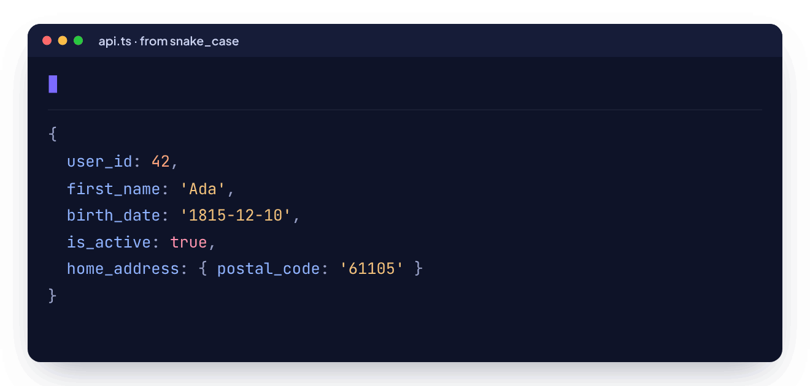

<div align="center">

<a href="https://github.com/NandoMB/caseparser">
  <picture>
    <source media="(prefers-color-scheme: dark)" srcset="https://raw.githubusercontent.com/NandoMB/caseparser/main/.github/assets/logo-dark.svg">
    
  </picture>
</a>

<h3>Convert strings and object keys to any case, from any case, with the result typed by TypeScript.</h3>

[](https://www.npmjs.com/package/caseparser)
[](https://jsr.io/@nandomb/caseparser)
[](https://jsr.io/@nandomb/caseparser)
[](https://github.com/NandoMB/caseparser/actions/workflows/main.yml)
[](https://bundlejs.com/?q=caseparser)
[](https://www.npmjs.com/package/caseparser)
[](#type-inference)
[](./LICENSE)
[](https://socket.dev/npm/package/caseparser)

<p>
  <a href="#installation"><b>Install</b></a> ·
  <a href="#quick-start"><b>Quick start</b></a> ·
  <a href="#cases"><b>Cases</b></a> ·
  <a href="#options"><b>Options</b></a> ·
  <a href="#type-inference"><b>Types</b></a> ·
  <a href="#benchmarks"><b>Benchmarks</b></a> ·
  <a href="#security"><b>Security</b></a>
</p>

<br>

<picture>
  <source media="(prefers-color-scheme: dark)" srcset="https://raw.githubusercontent.com/NandoMB/caseparser/main/.github/assets/demo-dark.gif">
  
</picture>

</div>

<br>

<table>
<tr>
<td width="25%" valign="top"><b>Any case in</b><br><sub>You don't need to know or normalize the input first. One object can mix keys in different cases.</sub></td>
<td width="25%" valign="top"><b>Deep</b><br><sub>Nested objects and objects inside arrays get converted too. Values stay as they are.</sub></td>
<td width="25%" valign="top"><b>Typed</b><br><sub>TypeScript infers the new keys, so your editor autocompletes them and catches typos.</sub></td>
<td width="25%" valign="top"><b>Fast and small</b><br><sub>5 to 25× faster on API responses. 1.8 KB gzipped with zero dependencies, and tree-shakeable.</sub></td>
</tr>
</table>

It ships as ESM and CommonJS on [npm](https://www.npmjs.com/package/caseparser) and [JSR](https://jsr.io/@nandomb/caseparser), and runs on Node.js, Bun, Deno, browsers and Cloudflare Workers.

> [!NOTE]
> The docs for version 1.x are on the [v1.x.x branch](https://github.com/NandoMB/caseparser/tree/v1.x.x).

## Installation

```sh
npm add caseparser    # or: pnpm add caseparser / yarn add caseparser
```

From JSR:

```sh
deno add jsr:@nandomb/caseparser
npx jsr add @nandomb/caseparser   # or: bunx jsr add @nandomb/caseparser
```

```ts
import { toSnake } from '@nandomb/caseparser';
```

## Quick start

Pass in an object and every key comes back in the new case, at any depth, whatever case it started in:

```ts
import { toCamel } from 'caseparser';        // ESM
// const { toCamel } = require('caseparser'); // CommonJS

const response = {
  userId: 42,                               // camelCase
  FirstName: 'Ada',                         // PascalCase
  last_name: 'Lovelace',                    // snake_case
  'birth-date': '1815-12-10',               // kebab-case
  ACCOUNT_STATUS: 'active',                 // UPPER_SNAKE_CASE
  'Content-Type': 'application/json',       // Train-Case
  'Display Name': 'Countess',               // Title Case
  XMLHttpRequest: false,                    // acronym + word
  $ref: '#/users/42',                       // symbol
  'billing address': {                      // nested objects...
    'Postal Code': '61105',
    countryISO: 'US'
  },
  'recent.orders': [{ order_id: 1, TotalAmount: 99.9 }], // ...and objects inside arrays
  tags: ['someTag', 'another_tag']          // values are never converted
};

toCamel(response);
// {
//   userId: 42,
//   firstName: 'Ada',
//   lastName: 'Lovelace',
//   birthDate: '1815-12-10',
//   accountStatus: 'active',
//   contentType: 'application/json',
//   displayName: 'Countess',
//   xmlHttpRequest: false,
//   ref: '#/users/42',
//   billingAddress: { postalCode: '61105', countryIso: 'US' },
//   recentOrders: [{ orderId: 1, totalAmount: 99.9 }],
//   tags: ['someTag', 'another_tag']
// }
```

Strings work the same way: `toSnake('helloWorld')`, `toSnake('Hello World')` and `toSnake('HELLO-WORLD')` all return `'hello_world'`.

The input is never mutated; you always get a new object. A common use is converting API payloads on the way in and on the way out:

```ts
import { toCamel, toSnake } from 'caseparser';

const res = await fetch('/api/users/1');
const user = toCamel(await res.json());   // { firstName, lastName, ... }

await fetch('/api/users/1', {
  method: 'PUT',
  body: JSON.stringify(toSnake(user)),    // back to { first_name, ... }
});
```

## Cases

There is one function per target case, and each one takes input in any case.

| Function | `'helloWorld'` → | `'LAST_login_AT'` → | Also known as |
| --- | --- | --- | --- |
| `toCamel` | `helloWorld` | `lastLoginAt` | lowerCamelCase |
| `toPascal` | `HelloWorld` | `LastLoginAt` | UpperCamelCase |
| `toSnake` | `hello_world` | `last_login_at` | |
| `toKebab` | `hello-world` | `last-login-at` | dash-case, param-case |
| `toUpperSnake` | `HELLO_WORLD` | `LAST_LOGIN_AT` | CONSTANT_CASE, SCREAMING_SNAKE_CASE |
| `toUpperKebab` | `HELLO-WORLD` | `LAST-LOGIN-AT` | COBOL-CASE, SCREAMING-KEBAB-CASE |
| `toTrain` | `Hello-World` | `Last-Login-At` | Header-Case |
| `toTitle` | `Hello World` | `Last Login At` | Capital Case |
| `toSentence` | `Hello world` | `Last login at` | |
| `toPascalSnake` | `Hello_World` | `Last_Login_At` | Ada_Case, Title_Snake_Case |
| `toLower` | `hello world` | `last login at` | no case |
| `toUpper` | `HELLO WORLD` | `LAST LOGIN AT` | |
| `toDot` | `hello.World` | `LAST.login.AT` | dot.notation |
| `toPath` | `hello/World` | `LAST/login/AT` | |
| `toSpace` | `hello World` | `LAST login AT` | |

`toDot`, `toPath` and `toSpace` only change the separator, so each word keeps its original case. To change it, use [`transform`](#transform).

## Options

Every function takes an optional second argument.

### `allowSymbols`

By default, symbols (ASCII punctuation such as `$`, `@`, `#` and `%`) are removed. Set it to `true` to keep all of them, or to an array to keep only the ones listed. You can also pass it directly as the second argument:

```ts
const data = { $ref: 1, '@type': 'User', 'discount%': 10 };

toCamel(data);                          // { ref: 1, type: 'User', discount: 10 }
toCamel(data, { allowSymbols: true });  // { $ref: 1, '@type': 'User', 'discount%': 10 }
toCamel(data, { allowSymbols: ['$'] }); // { $ref: 1, type: 'User', discount: 10 }

toCamel(data, true);  // shorthand for { allowSymbols: true }
toCamel(data, ['$']); // shorthand for { allowSymbols: ['$'] }
```

A kept symbol sticks to the start of the next word, so `toPascal('$id', true)` returns `'$Id'`. The rules are in [how keys are split into words](#how-keys-are-split-into-words).

### `ignore`

A list of object keys to leave alone, at any depth. Their values still get converted:

```ts
toCamel({ _id: 1, user_id: 2, extra_data: { inner_key: 3 } }, { ignore: ['_id', 'extra_data'] });
// { _id: 1, userId: 2, extra_data: { innerKey: 3 } }
```

Keys must match exactly as they appear in the input, and the inferred type keeps them unchanged too. `ignore` only applies to object keys, so `toSnake('userId', { ignore: ['userId'] })` still returns `'user_id'`.

### `transform`

Only for `toDot` and `toPath`. It sets the case of the whole result, object keys included, to `'lowercase'` or `'uppercase'`:

```ts
toDot('LAST_login_AT');                              // 'LAST.login.AT'
toDot('LAST_login_AT', { transform: 'lowercase' });  // 'last.login.at'
toPath('LAST_login_AT', { transform: 'uppercase' }); // 'LAST/LOGIN/AT'

toDot({ user_ID: 1, LAST_name: 'Doe' }, { transform: 'lowercase' });
// { 'user.id': 1, 'last.name': 'Doe' }

toDot('$UserId', { allowSymbols: true, transform: 'lowercase' }); // '$user.id'
```

For `toSpace`, use `toLower` or `toUpper` instead. Avoid chaining functions like `toUpper(toPath(...))`, because each one splits its input into words again and treats `/` and `.` as separators or symbols.

### `separator`

Only for `toPath`. It joins words with `'/'` (the default) or `'\\'`:

```ts
toPath('users/profilePicture');                      // 'users/profile/Picture'
toPath('users/profilePicture', { separator: '\\' }); // 'users\\profile\\Picture'
toPath('users\\profilePicture', { separator: '/' }); // 'users/profile/Picture'
```

In `toPath`, a `/` or `\` in the input also starts a new word, which lets you convert a path from one separator to the other. Every other function treats them as symbols.

## Type inference

TypeScript computes the converted keys, so your editor autocompletes them and flags typos:

```ts
const user = toCamel({ first_name: 'John', 'Home Addresses': [{ POSTAL_CODE: '61105' }] });
//    ^? { firstName: string; homeAddresses: { postalCode: string }[] }

user.firstName;  // ✅
user.first_name; // ❌ Property 'first_name' does not exist
```

The inference takes options into account: `toCamel({ $ref: 1 }, ['$'])` is typed `{ $ref: number }`, and `toDot({ UserId: 1 }, { transform: 'lowercase' })` is typed `{ 'user.id': number }`. If the options are only known at runtime, such as a `boolean` variable, the keys are typed as `string`.

## How keys are split into words

Every function first splits the input into words and then joins them in the target case. A new word starts:

- at a separator (`_`, `-`, `.` or a space), which is removed. Repeated or leading separators are ignored, so `toSnake('__private_flag')` returns `'private_flag'`.
- at an uppercase letter that follows a lowercase letter or a digit: `helloWorld` becomes `hello` and `world`.
- at the last letter of an acronym: `XMLHttpRequest` becomes `xml`, `http` and `request`, and `userID` becomes `user` and `id`.
- at a symbol, whether it is kept or not.
- at `/` or `\`, in `toPath` only.

Digits stay with the word before them: `toSnake('html5Parser')` returns `'html5_parser'`.

A kept symbol sticks to the start of the next word, or to the end of the previous one if no word follows:

```ts
toSnake('$$hello$World$$hi');       // 'hello_world_hi'
toSnake('$$hello$World$$hi', true); // '$$hello_$world_$$hi'
toSnake('user@name', true);         // 'user_@name'
toSnake('total%_count', true);      // 'total%_count'
```

The inferred types follow the same rules.

## Behavior and limitations

- Only keys are converted. In `{ userName: 'johnDoe' }` the key becomes `user_name` and `'johnDoe'` stays as it is, and so do strings inside arrays.
- Only plain objects are traversed. `Date`, `Map`, `Set`, class instances and `Object.create(null)` objects come back as they are, with the same reference.
- Acronyms are kept together but not restored: `toSnake('userID')` returns `'user_id'`, and `toCamel('user_id')` returns `'userId'`.
- Words are lowercased first, except in `toDot`, `toPath` and `toSpace`, so `toCamel('X-API-Key')` returns `'xApiKey'`.
- Title Case capitalizes every word, short ones included: `toTitle('termsOfUse')` returns `'Terms Of Use'`.
- Very deep or circular objects throw `RangeError: Maximum call stack size exceeded`, starting at about 5,000 levels with the default Node.js stack. `JSON.parse` accepts that depth, so if you don't handle the error, limit the depth of untrusted input.
- Type inference works for keys up to about 120 characters. Longer keys fail to compile with `Type instantiation is excessively deep and possibly infinite`. The runtime has no such limit.

### Design trade-offs

- Nothing is cached between calls. Within a single call each distinct key is converted once, so an array of 100 items costs about as much as one item. Libraries that cache keys across calls (camelcase-keys keeps up to 2 × 100,000) are faster when the same small object is converted again and again, but they hold that memory for the life of the process, and untrusted keys can fill it. See [memory](./bench/results/memory.md).
- The key cache is only created for arrays, where objects usually share keys. A single object doesn't pay for it, but keys repeated in nested objects outside arrays are converted again.
- `toCamel` and `toSnake` on their own take 1.5 KB gzipped, against 0.8 KB in 5.1.0, because of the character tables and the key cache that make them faster. The whole package is smaller than before (1.8 KB gzipped, down from 3.1 KB in 5.1.0), since 6.0 removed the deprecated functions.
- Every function splits words the same way, including acronyms, digits, symbols and non-ASCII letters, even where a simpler rule would be faster for plain `snake_case` to `camelCase`.

## Benchmarks

Measured on Node.js 24, on an Apple M3 Pro:

- With an API response of 100 users (2,104 keys), caseparser is the fastest in every case, 5 to 25× faster than the others: about 57 µs, against 269 µs to 1.39 ms.
- With 1,000 unique keys, it is the fastest or tied with the fastest in every case.
- It allocates the least memory per call (121 KB for the API response, while the others use 1.2 to 2.9 MB) and keeps nothing between calls.
- When a small object (8 keys) is converted over and over, camelcase-keys is faster to camelCase (0.71 µs against 0.96 µs) thanks to its cross-call cache. caseparser is the fastest to snake_case (0.92 µs) and for strings (1.1 µs for 10 strings, against 1.4 µs for es-toolkit).

Each time is the mean of the medians of 3 rounds, with the libraries in a different order each round. Bold marks the fastest library and any library tied with it (overlapping rounds). ❌ means the library can't convert keys to that case.

<details>
<summary><b>Speed: API response with 100 users (2,104 keys)</b></summary>

<br>

Every user has the same keys, as in a real API response.

| Case | caseparser | caseparser@5.1.0 | change-case | camelcase-keys | snakecase-keys | humps | es-toolkit |
| --- | ---: | ---: | ---: | ---: | ---: | ---: | ---: |
| camelCase | **57 µs** | 936 µs | 929 µs | 269 µs | ❌ | 536 µs | 391 µs |
| PascalCase | **58 µs** | 1.04 ms | 1.01 ms | 361 µs | ❌ | 629 µs | 496 µs |
| snake_case | **57 µs** | 870 µs | 1.06 ms | ❌ | 1.34 ms | 397 µs | 377 µs |
| kebab-case | **57 µs** | 884 µs | 1.07 ms | ❌ | 1.38 ms | 399 µs | 382 µs |
| UPPER_SNAKE | **58 µs** | 923 µs | 1.11 ms | ❌ | ❌ | ❌ | 448 µs |
| UPPER-KEBAB | **58 µs** | 936 µs | 1.13 ms | ❌ | ❌ | ❌ | ❌ |
| Train-Case | **58 µs** | 1.07 ms | 1.17 ms | ❌ | ❌ | ❌ | ❌ |
| Title Case | **58 µs** | 1.08 ms | 1.16 ms | ❌ | ❌ | ❌ | ❌ |
| Sentence case | **57 µs** | 972 µs | 1.14 ms | ❌ | ❌ | ❌ | ❌ |
| Pascal_Snake | **58 µs** | 1.07 ms | 1.15 ms | ❌ | ❌ | ❌ | ❌ |
| lower case | **57 µs** | 902 µs | 1.07 ms | ❌ | 1.39 ms | 402 µs | ❌ |
| UPPER CASE | **58 µs** | 936 µs | 1.13 ms | ❌ | ❌ | ❌ | ❌ |
| dot.case | **56 µs** | 879 µs | 1.07 ms | ❌ | 1.38 ms | 402 µs | ❌ |
| path/case | **57 µs** | 946 µs | 1.07 ms | ❌ | 1.38 ms | 401 µs | ❌ |

</details>

<details>
<summary><b>Speed: one object with 1,000 unique keys</b></summary>

<br>

No key repeats, so this measures the cost of converting each key. The scenario creates a lot of garbage, so results vary by up to ~20% between rounds for every library.

| Case | caseparser | caseparser@5.1.0 | change-case | camelcase-keys | snakecase-keys | humps | es-toolkit |
| --- | ---: | ---: | ---: | ---: | ---: | ---: | ---: |
| camelCase | **276 µs** | 1.94 ms | 740 µs | 1.09 ms | ❌ | 526 µs | 417 µs |
| PascalCase | **346 µs** | 1.48 ms | 827 µs | 1.33 ms | ❌ | 596 µs | 502 µs |
| snake_case | **291 µs** | 1.90 ms | 813 µs | ❌ | 892 µs | **421 µs** | **385 µs** |
| kebab-case | **413 µs** | 1.34 ms | 906 µs | ❌ | 960 µs | **468 µs** | **422 µs** |
| UPPER_SNAKE | **392 µs** | 1.98 ms | 911 µs | ❌ | ❌ | ❌ | **453 µs** |
| UPPER-KEBAB | **482 µs** | 874 µs | 949 µs | ❌ | ❌ | ❌ | ❌ |
| Train-Case | **381 µs** | 2.08 ms | 936 µs | ❌ | ❌ | ❌ | ❌ |
| Title Case | **461 µs** | 937 µs | 979 µs | ❌ | ❌ | ❌ | ❌ |
| Sentence case | **362 µs** | 1.98 ms | 900 µs | ❌ | ❌ | ❌ | ❌ |
| Pascal_Snake | **444 µs** | 1.45 ms | 961 µs | ❌ | ❌ | ❌ | ❌ |
| lower case | **343 µs** | 1.67 ms | 877 µs | ❌ | 938 µs | **444 µs** | ❌ |
| UPPER CASE | **464 µs** | 853 µs | 951 µs | ❌ | ❌ | ❌ | ❌ |
| dot.case | **367 µs** | 1.94 ms | 871 µs | ❌ | 934 µs | **444 µs** | ❌ |
| path/case | **449 µs** | 855 µs | 917 µs | ❌ | 974 µs | 521 µs | ❌ |

</details>

<details>
<summary><b>Memory</b></summary>

<br>

Heap used on Node.js, with a fresh process for each library:

| Library | Loading the library | One call: API response | One call: 1,000 unique keys | Kept after converting 256,000 keys |
| --- | ---: | ---: | ---: | ---: |
| caseparser | 71 KB | **121 KB** | **516 KB** | 0 |
| caseparser@5.1.0 | 289 KB | 2,348 KB | 2,719 KB | 0 |
| change-case | 135 KB | 2,850 KB | 1,610 KB | 0 |
| camelcase-keys | 210 KB | 1,516 KB | 1,742 KB | 11,488 KB |
| humps | **62 KB** | 1,183 KB | 759 KB | 0 |
| es-toolkit | 623 KB | 1,745 KB | 1,062 KB | 0 |

"One call" is the memory allocated to convert to camelCase, including the result (62 KB and 48 KB). "Kept" is what is still in use after the calls; 0 means under 10 KB, which is within the noise of the measurement.

</details>

<details>
<summary><b>Features compared with the same libraries</b></summary>

<br>

| | caseparser | change-case | camelcase-keys | snakecase-keys | humps | es-toolkit |
| --- | :---: | :---: | :---: | :---: | :---: | :---: |
| Cases for object keys | 14 | 14 | 2 | 5 | 7 | 5 |
| Mixed cases in one object | ✅ | ✅ | ✅ | ✅ | ❌ | ✅ |
| `Date` and `Map` values still work | ✅ | ❌ | ✅ | ❌ | ❌ | ✅ |
| Class instances kept as they are | ✅ | ❌ | ❌ | ❌ | ❌ | ✅ |
| Types the converted keys | ✅ | ❌ | ✅ | ✅ | ❌ | ⚠️ |
| Can skip keys | ✅ | ❌ | ✅ | ✅ | ✅ | ❌ |
| Dependencies | 0 | 0 | 5 | 3 | 0 | 0 |

change-case types the result as `unknown` and humps as `object`, and es-toolkit types some keys differently from what it returns. snakecase-keys and humps break `Map` values, and change-case breaks `Date` and `Map`. camelcase-keys, snakecase-keys and humps turn class instances into plain objects. With `__proto__` in untrusted JSON, `humps.decamelizeKeys` replaces the result's prototype, and snakecase-keys throws on a `constructor` key. The others, caseparser included, convert both.

Edge cases also differ: `userID` can become `user_id` or `user_i_d`, and `html5Parser` can become `html5_parser` or `html_5_parser`. See [what each library returns](./bench/results/edge-cases.md).

</details>

Before anything is timed, each library's output is checked against the expected result. Each library is called from [its own file](./bench/libraries) with its documented options. The method, the raw numbers of every round, the date and the versions are in [`bench/`](./bench). To run the benchmarks yourself:

```sh
pnpm install
pnpm benchmark
```

## Compatibility

| Environment | Supported |
| --- | --- |
| ESM (`import`) | Node.js 22+, Deno, Bun, bundlers |
| CommonJS (`require`) | Node.js 22+, Bun |
| TypeScript | 4.7+ (any `moduleResolution`: `node`, `node16`/`nodenext`, `bundler`) |
| Browsers | Any ES2015 browser (via bundler) |
| Edge | Cloudflare Workers ([example](./examples/cloudflare-worker)) |

CI runs the tests on Node.js 22, 24 and 26, Bun, Deno, Chromium, Firefox and WebKit, and runs [a Cloudflare Worker](./examples/cloudflare-worker) on workerd against the packed package. It also checks the package with [publint](https://publint.dev) and [Are the Types Wrong?](https://arethetypeswrong.github.io) for ESM, CommonJS and every `moduleResolution`, and compiles the type declarations with TypeScript 4.7.

## Security

caseparser is safe to use on untrusted input, such as request bodies or `JSON.parse` output:

- `__proto__` is copied as a regular key and never changes an object's prototype.
- An object with a `constructor` key is converted like any other.
- Only own properties are converted, and nothing is kept between calls.

If you don't handle the `RangeError` thrown on very deep objects, limit the depth of untrusted input (see [limitations](#behavior-and-limitations)).

Releases are built and published from GitHub Actions with OIDC instead of long-lived tokens, and with [npm provenance](https://docs.npmjs.com/generating-provenance-statements), so you can trace every version back to the commit and workflow that built it. New npm versions are [staged](https://docs.npmjs.com/staged-publishing/) and only go live after a maintainer approves them with 2FA.

To report a vulnerability, follow [SECURITY.md](./SECURITY.md) and report it privately.

## License

<p align="center">
  <br>
  <a href="./LICENSE">MIT</a> © 2017 <a href="https://github.com/NandoMB">Fernando Machado Bernardino</a><br>
  <sub>If caseparser saves you time, a ⭐ on <a href="https://github.com/NandoMB/caseparser">GitHub</a> helps others find it.</sub>
</p>
